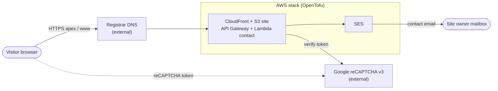

# Minimal AWS hosting

### This project is about creating hosting with zero cost on AWS infrastructure.

Minimal-TCO static site on AWS: one S3 bucket, one CloudFront distribution, path-based routing, a Lambda-backed contact form (reCAPTCHA v3 + SES), and AWS Budgets cost alerts.

The public website in `website/` is synced to S3 by `tofu apply`.

## Architecture



- **One CloudFront distribution** is the single public entry point. Visitors reach it through the registrar's DNS (apex and `www`), and path routing sends each request to the right origin.
- **Static site:** `/` and `/photos/*` are served from one private, versioned S3 bucket through an origin access control. `website/` is synced to it on `tofu apply`.
- **Contact API:** `/api/*` goes to API Gateway and the `lambda/contact` function. It validates the request, checks the reCAPTCHA v3 token with Google, and sends the message through SES to the owner.

More diagrams:

- Request routing and regions: [docs/DEPLOYMENT.md](docs/DEPLOYMENT.md)
- Deploy sequence and module dependencies: [infra/README.md](infra/README.md)
- Contact handler request flow: [lambda/contact/README.md](lambda/contact/README.md)

## Layout

```
infra/           OpenTofu — bootstrap, modules, dev/prod environments
lambda/contact/  Contact form handler (validation, reCAPTCHA v3, SES) + unit tests
website/         Static public site (synced to S3 on tofu apply)
docs/            Project context, architecture diagrams, budget
```

## Quick start

1. **Bootstrap remote state** (once per AWS account):

   ```bash
   cd infra/bootstrap
   cp terraform.tfvars.example terraform.tfvars   # edit tags/region
   tofu init && tofu apply
   tofu output   # note state_bucket_name, lock_table_name
   ```

   Bootstrap keeps its own state **locally** in `infra/bootstrap/terraform.tfstate`. Back this file up and do not commit it.

2. **Prod infra**:

   ```bash
   cd infra/environments/prod
   cp terraform.tfvars.example terraform.tfvars   # edit domain, emails, recaptcha_secret_key, IAM boundary
   cp backend.hcl.example backend.hcl             # set bucket/table/region from bootstrap outputs
   tofu init -reconfigure -backend-config=backend.hcl
   tofu apply
   ```

3. **Upload site content** — automatic on `tofu apply` from `website/`; or manual `aws s3 sync` if preferred.

4. **Full deployment guide** — see [infra/README.md](infra/README.md) (deploy sequence diagram, ACM, DNS, SES).

## Environments

| | dev | prod |
|---|---|---|
| State | local | S3 remote (bootstrap) |
| Custom domain | no | yes (after ACM + DNS) |
| SES / contact form | no | yes |
| Budget alerts | no | yes ($50/month, alerts at ~$5 / $20 / $50) |

## Contact API

`POST /api/contact` — see [lambda/contact/README.md](lambda/contact/README.md) for the request/response contract and tests.

## Configuration

All environment-specific values belong in **gitignored** files:

- `infra/environments/prod/terraform.tfvars`
- `infra/environments/prod/backend.hcl`
- `infra/bootstrap/terraform.tfvars`
- `infra/bootstrap/terraform.tfstate` (bootstrap local state)

Never commit account IDs, emails, domains, ARNs or the reCAPTCHA secret — use the `*.example` templates.

See [docs/CONTEXT.md](docs/CONTEXT.md) for architecture and operational notes.

See [docs/DEPLOYMENT.md](docs/DEPLOYMENT.md) for the request flow diagram and regions.

See [docs/BUDGET.md](docs/BUDGET.md) for cost of ownership and free tier estimates.
