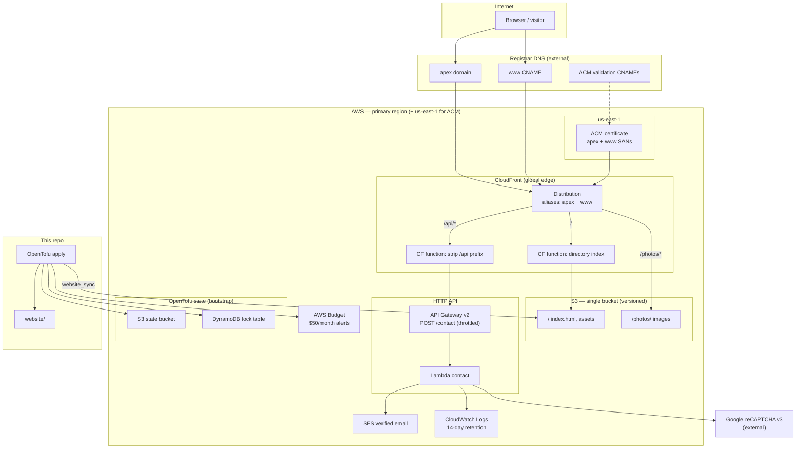
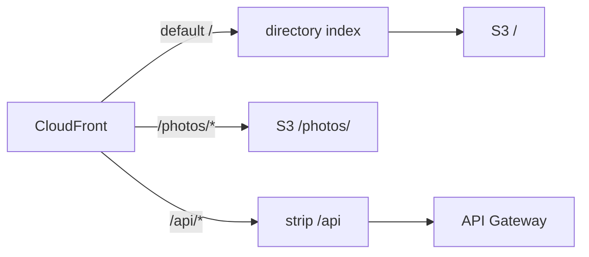
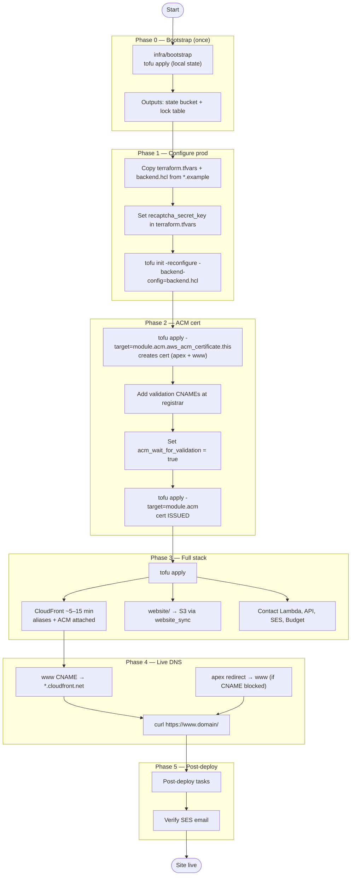
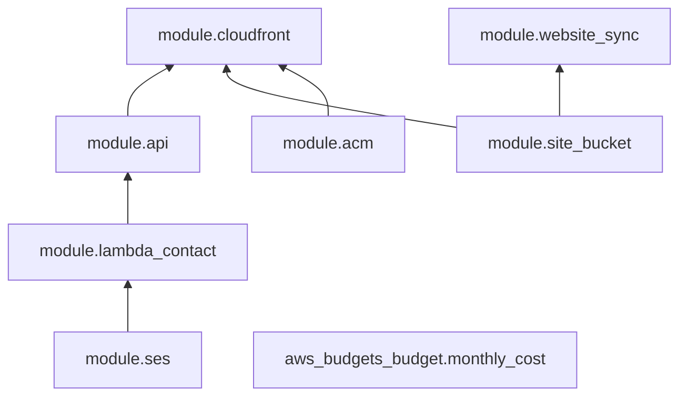
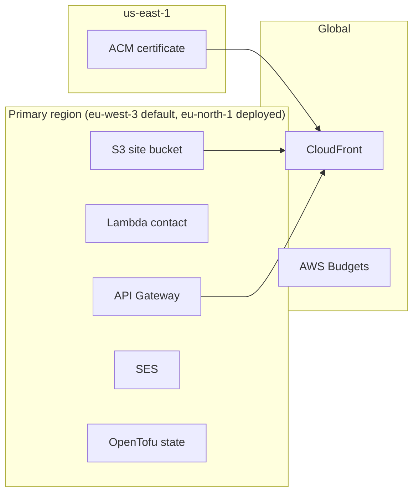

# Deployment architecture

Mermaid diagrams for the minimal-aws hosting stack. The admin panel is TBD and not shown.

Regions: code defaults to **eu-west-3**; the current deployment runs in **eu-north-1**. Diagrams say "primary region" for either. ACM is always in **us-east-1**.

## Runtime architecture

## Path routing (CloudFront)

## Deployment sequence

## OpenTofu module dependency graph

`aws_budgets_budget.monthly_cost` has no dependencies on other modules. `module.cloudfront` also has an explicit `depends_on = [module.api]`.

## Regions

## Related docs

- [CONTEXT.md](CONTEXT.md) — decisions and target state
- [../infra/README.md](../infra/README.md) — step-by-step runbook
