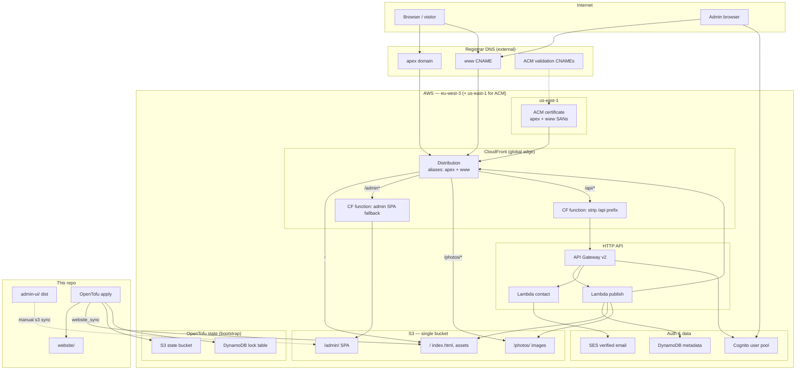
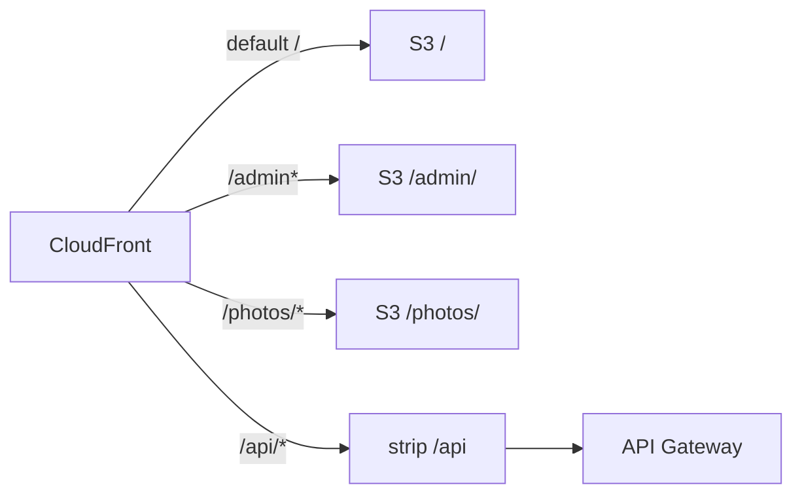
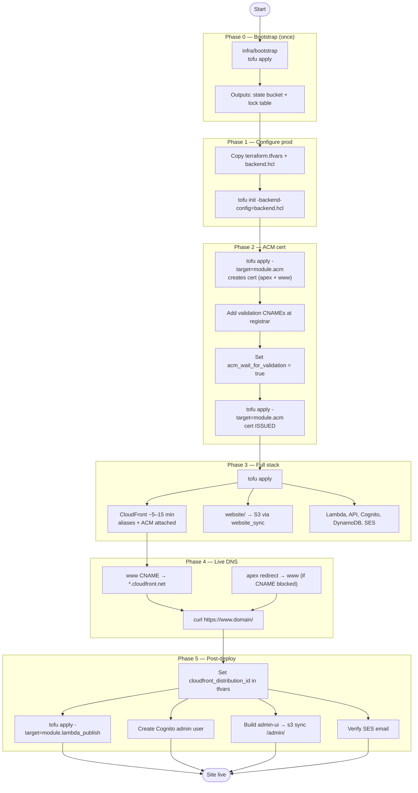
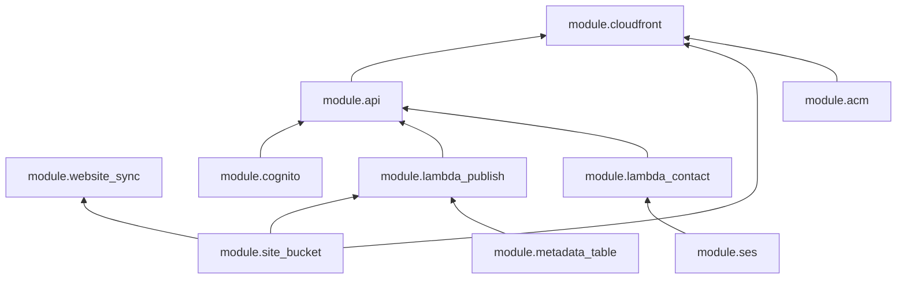
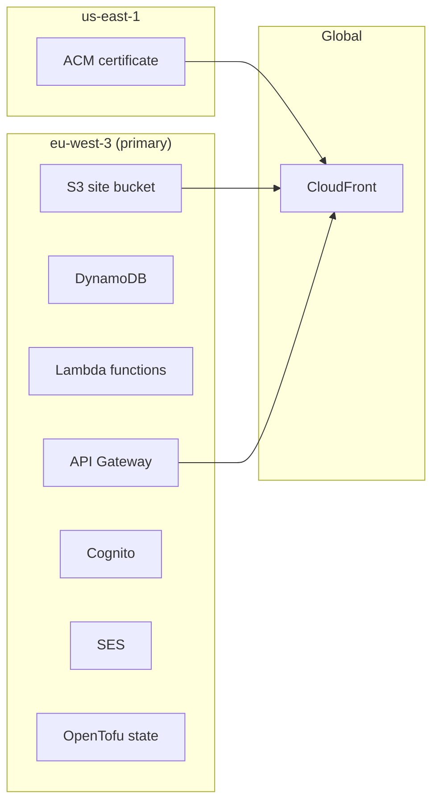

# Deployment architecture

Mermaid diagrams for the minimal-aws hosting stack.

## Runtime architecture

## Path routing (CloudFront)

## Deployment sequence

## OpenTofu module dependency graph

## Regions

## Related docs

- [CONTEXT.md](CONTEXT.md) — decisions and target state
- [../infra/README.md](../infra/README.md) — step-by-step runbook
