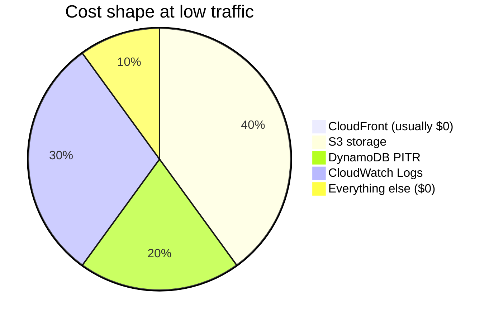

# Cost of ownership (TCO)

Estimated running costs for the **minimal-aws** stack: static site + contact API on CloudFront, S3, Lambda, API Gateway, SES, plus Cognito and DynamoDB reserved for the admin project (separate, TBD).

**Region:** code defaults to **eu-west-3** (Paris); the current deployment runs in **eu-north-1** (Stockholm). Prices below are close for both, but re-check for eu-north-1. ACM cert in **us-east-1** (required by CloudFront, no extra cert charge).

Prices are **approximate USD**, pay-as-you-go. Verify on the [AWS Pricing Calculator](https://calculator.aws/) and [AWS Free Tier](https://aws.amazon.com/free/) — AWS updates rates and free-tier rules periodically.

---

## Billable resources in this stack

| Service | Resource | Billing model | Notes |
|---|---|---|---|
| **CloudFront** | 1 distribution, PriceClass_100 | Per request + data transfer out | S3→CloudFront origin transfer is **free** |
| **CloudFront Functions** | 3 functions (directory index, API strip, admin SPA) | Per invocation | Cheap; 2M invocations/month always free |
| **S3** | Site bucket + OpenTofu state bucket | Storage + requests | No public internet egress (CloudFront/OAC only). Both versioned; site bucket expires old versions after 30 days |
| **Lambda** | `contact` (128 MB, 10 s) | Per request + GB-seconds | ARM64, Python 3.12 |
| **API Gateway** | HTTP API (v2) | Per million requests | No REST API premium features; contact route throttled (burst 10, 5 rps) |
| **DynamoDB** | Metadata table, on-demand (reserved for admin project) | Per read/write request + storage | **PITR enabled in prod** (extra line item) |
| **DynamoDB** | State lock table (bootstrap) | On-demand | Negligible |
| **Cognito** | 1 user pool, admin client (reserved for admin project) | Per MAU | 1–few admin users |
| **SES** | Verified email identity | Per email sent | Contact form only |
| **ACM** | TLS cert (apex + www) | — | **Free** |
| **CloudWatch Logs** | Lambda execution logs | Ingestion + storage | 14-day retention set in code; ingestion is the first “surprise” at scale |
| **AWS Budgets** | 1 cost budget ($50/month, 3 email alerts) | — | **Free** (no budget actions) |

**Not in this stack (no cost from Terraform):** EC2, ALB, NAT Gateway, Route 53 hosted zone, RDS, ElastiCache, WAF.

**External (non-AWS):** domain registration/renewal at your registrar (e.g. `.com.ua`); Google reCAPTCHA v3 for the contact form (free tier).

---

## AWS Free Tier — what applies here

AWS free tier depends on **account age and plan**. Since **July 2025**, new accounts choose a **Free plan** (credits, 6-month window) or **Paid plan** (credits + pay-as-you-go). Many services also have **always-free monthly allowances** that reset each month.

Relevant **always-free** limits (typical — confirm for your account):

| Service | Always-free allowance (monthly) | Fits this stack? |
|---|---|---|
| **CloudFront** | 1 TB data transfer out, 10M HTTP(S) requests | Yes — main public traffic |
| **Lambda** | 1M requests, 400K GB-seconds | Yes — contact form |
| **DynamoDB** | 25 GB storage, 25 RCU/WCU worth of on-demand* | Yes — small metadata table |
| **Cognito** | 50,000 MAU | Yes — few admins |
| **S3** | 5 GB storage (often 12-month for new accounts) | Yes — small static site |
| **API Gateway HTTP** | 1M requests (often **12-month** for new accounts) | Yes — low API volume |
| **SES** | 3,000 messages/month (12-month) when out of sandbox | Contact form only |
| **CloudWatch** | 5 GB log ingestion (limited always-free) | Watch Lambda logs |

\*On-demand DynamoDB free tier is expressed as read/write units; small apps stay within it.

**Important caveats**

- **S3 direct egress to internet is not free** — this design avoids it by serving only via CloudFront.
- **DynamoDB PITR** (enabled in prod) is **not** covered by free tier (~$0.20/GB-month of table size).
- **CloudFront invalidations** — first 1,000 paths/month free; then ~$0.005/path (manual invalidations, or the future admin publish flow).
- **SES sandbox** — new accounts can only send to verified addresses until you request production access.
- **Legacy accounts** (created before July 2025) may still be on the old 12-month free-tier model.

---

## Cost scenarios

Assumptions unless noted:

- Average page weight **150 KB** (HTML + assets; photos cached at `/photos/*`).
- **90%** of traffic served from CloudFront cache (repeat visitors).
- **1 admin**, contact form **50 emails/month**.
- Site bucket **< 2 GB**, metadata table **< 100 MB**.

### A. Idle / personal site (typical now)

~**1,000** page views/month, **100** API calls, occasional admin publish.

| Component | Estimate |
|---|---|
| CloudFront | $0 (free tier) |
| S3 (site + state) | $0–0.10 |
| Lambda | $0 |
| API Gateway | $0 |
| DynamoDB (on-demand) | $0 |
| DynamoDB PITR | ~$0.02 |
| Cognito | $0 |
| SES | $0 |
| CloudWatch Logs | $0 |
| **Total** | **~$0–1 / month** |

### B. Small production site

~**50,000** page views/month, **5,000** API calls, **10** admin publishes.

| Component | Estimate |
|---|---|
| CloudFront (~7 GB transfer) | $0 |
| S3 | $0–0.25 |
| Lambda | $0 |
| API Gateway | $0 |
| DynamoDB | $0–0.50 |
| DynamoDB PITR | ~$0.05 |
| Cognito (≤50 MAU) | $0 |
| SES (50 emails) | $0 |
| CloudWatch Logs | $0–1 |
| **Total** | **~$0–2 / month** |

### C. Growing site

~**500,000** page views/month, **50,000** API calls, **500** photos (~5 GB in S3).

| Component | Estimate |
|---|---|
| CloudFront (~75 GB transfer) | $0 |
| S3 (~5 GB) | ~$0.12 |
| Lambda | $0–1 |
| API Gateway | $0 (within 1M free) |
| DynamoDB | ~$1–3 |
| DynamoDB PITR | ~$0.10 |
| Cognito | $0 |
| SES | $0 |
| CloudWatch Logs | ~$1–3 |
| **Total** | **~$2–8 / month** |

### D. High traffic

~**5,000,000** page views/month, **500,000** API calls, **50 GB** photo library.

| Component | Estimate |
|---|---|
| CloudFront (~750 GB transfer) | $0 (still under 1 TB free) |
| S3 (~50 GB) | ~$1.15 |
| Lambda | ~$2–10 |
| API Gateway | $0 (within 1M) or ~$1 if over |
| DynamoDB | ~$5–15 |
| DynamoDB PITR | ~$0.50 |
| Cognito | $0 |
| SES | ~$0.50 |
| CloudWatch Logs | ~$5–15 |
| **Total** | **~$15–45 / month** |

### E. Very high traffic (free tier exhausted)

~**20,000,000** page views/month (~**3 TB** CDN egress), **5M** API calls.

| Component | Estimate |
|---|---|
| CloudFront (2 TB over 1 TB free × ~$0.085/GB) | **~$170** |
| CloudFront requests (over 10M) | ~$5–10 |
| S3 | ~$2–5 |
| Lambda | ~$10–40 |
| API Gateway (~4M billable × $1/M) | **~$4** |
| DynamoDB | ~$20–50 |
| DynamoDB PITR | ~$1–2 |
| CloudWatch Logs | **~$20–50** |
| **Total** | **~$230–330 / month** |

At this scale, add **AWS Budgets** alerts, log retention limits, and consider **WAF**, **cache tuning**, and **photo storage lifecycle** (S3 Intelligent-Tiering or separate media CDN).

---

## Fixed vs variable costs

| Cost type | Examples |
|---|---|
| **Fixed / baseline** | S3 storage, DynamoDB PITR, tiny state bucket, idle CloudFront distribution ($0 when idle) |
| **Variable with traffic** | CloudFront egress & requests, API Gateway, Lambda, DynamoDB reads/writes, SES sends |
| **Variable with ops** | CloudFront invalidations, `tofu apply` churn, log volume |

There is **no hourly charge** for CloudFront, Lambda (when not invoked), API Gateway (when idle), or Cognito (below MAU thresholds). You pay for **usage**, not “servers running 24/7” — that is the main TCO win vs EC2/ALB.

---

## Cost optimizations already in the design

| Choice | Savings |
|---|---|
| **CloudFront in front of S3** | Avoids S3 internet egress ($0.09/GB); 1 TB/month CDN free |
| **Single S3 bucket + prefixes** | One bucket policy, no extra buckets for admin/photos |
| **HTTP API (not REST)** | ~71% cheaper than REST API Gateway |
| **No ALB / EC2** | No hourly compute or NAT charges |
| **Lambda ARM64** | ~20% cheaper than x86 for same work |
| **DynamoDB on-demand** | No provisioned capacity idle cost |
| **PriceClass_100** | Cheaper CDN POP set (US/EU; fine for `.ua` audience) |
| **External DNS** | No Route 53 hosted zone ($0.50/month saved) |
| **ACM for TLS** | Free certificates |
| **AWS Budgets alerts** | $50/month budget, emails at ~$5 / $20 / $50 (`aws_budgets_budget.monthly_cost`) |
| **Lambda log retention 14 days** | Caps CloudWatch Logs storage (`log_retention_days`) |
| **S3 noncurrent-version expiry (30 days)** | Old object versions don't accumulate |
| **API throttling + reCAPTCHA on contact** | Limits API Gateway / Lambda / SES cost from abuse |

---

## Watch list (hidden costs)

1. **CloudFront invalidations** — when the admin publish flow is built, batch or narrow paths rather than invalidating `/*` on every publish.
2. **CloudWatch Logs** — retention is 14 days, but ingestion still bills per GB; keep handler logging lean.
3. **DynamoDB PITR** — disable in dev; keep in prod only if you need point-in-time recovery.
4. **SES** — sandbox limits; production access required for public contact forms.
5. **Large `/photos/` library** — S3 storage grows linearly; CloudFront caches but origin storage bills.
6. **API abuse** — the public contact route is throttled (burst 10, 5 rps) and protected by reCAPTCHA v3 + honeypot; admin routes should use the Cognito JWT authorizer. Revisit limits if traffic grows.
7. **Multi-environment** — dev + prod doubles baseline S3/DynamoDB/Cognito if both left running.

---

## Annual TCO summary

| Profile | Monthly | Annual (infra only) | + domain (~$15/yr .ua) |
|---|---|---|---|
| Personal / idle | $0–1 | $0–12 | ~$12–27 |
| Small production | $0–2 | $0–24 | ~$24–39 |
| Growing | $2–8 | $24–96 | ~$39–111 |
| High traffic | $15–45 | $180–540 | ~$195–555 |
| Very high (20M views) | $230–330 | $2,760–3,960 | ~$2,775–3,975 |

**Compared to a minimal VPS (~$5–10/month)** this stack is **cheaper or equal at low traffic**, and **scales without managing servers**. At **very high** CDN egress, a dedicated VPS or flat-rate CDN (e.g. Cloudflare Pro + R2) can become cheaper — but you lose the integrated AWS auth/API/DynamoDB path.

---

## Recommendations

1. Confirm the **AWS Budget** alert emails reach `admin_email` (budget is created by prod `tofu apply`).
2. Enable **Cost Explorer** cost allocation tags (`Project` from your tfvars, `Environment`).
3. Review **CloudWatch log volume** once the contact form gets real traffic.
4. Revisit **DynamoDB PITR** if the metadata table stays tiny and backups are not required.
5. Re-run estimates before launch using [AWS Pricing Calculator](https://calculator.aws/) with your expected page views and photo storage.

---

## Related docs

- [DEPLOYMENT.md](DEPLOYMENT.md) — architecture diagrams
- [CONTEXT.md](CONTEXT.md) — design decisions
- [../infra/README.md](../infra/README.md) — deploy runbook
