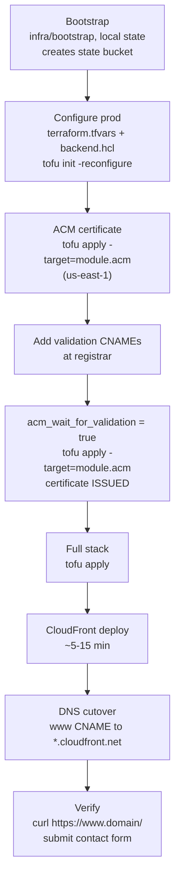
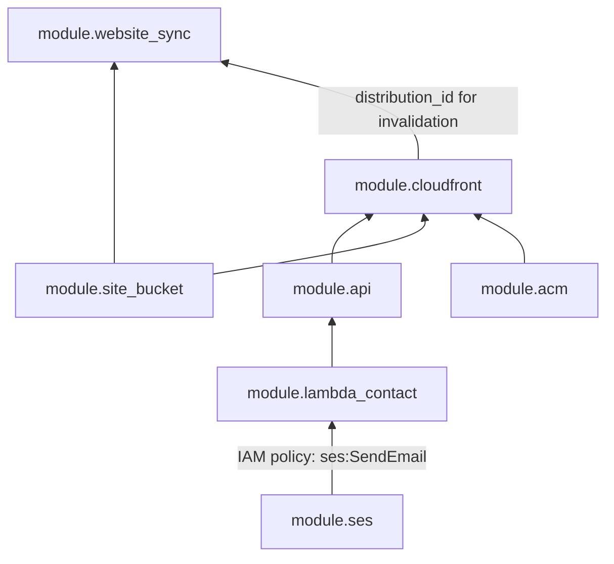

# Infrastructure — single domain, path routing

One custom domain, one CloudFront distribution, one S3 bucket with prefixes:

| Path | Origin |
|---|---|
| `/` (default) | S3 site root — CloudFront function rewrites `/about/` and `/about` to `/about/index.html` |
| `/photos/*` | S3 `photos/` (cached 1 day by default, up to 1 year) |
| `/api/*` | API Gateway (CloudFront function strips `/api` prefix, no caching) |

Missing objects are served as **404** with `/404.html` (CloudFront rewrites S3's 403 to 404). `website/` has no `404.html` yet, so CloudFront cannot fetch the error page and returns a bare error; add one.

No subdomains (except `www`). No ALB. ACM certificate in **us-east-1** for CloudFront.

## Prerequisites

- OpenTofu >= 1.6, AWS CLI configured
- IAM permissions boundary on Lambda roles (if your org requires it)
- DNS managed at your registrar (external to Route 53)
- Google reCAPTCHA v3 site key (in the website) and secret key (for the contact Lambda)

## Regions

Code defaults to **eu-west-3**; the current deployment uses **eu-north-1** (set via `aws_region` in `terraform.tfvars` and `region` in `backend.hcl`). ACM is always in us-east-1.

## Bootstrap (remote state)

```bash
cd infra/bootstrap
cp terraform.tfvars.example terraform.tfvars
tofu init && tofu apply
```

Bootstrap uses local state (`infra/bootstrap/terraform.tfstate`) — back it up, don't commit it.

Record outputs:

```bash
tofu output -raw state_bucket_name    # e.g. minimal-aws-tofu-state
```

## Prod deploy sequence



Notes:

- `tofu apply` also syncs `website/` to S3 with the AWS CLI and invalidates CloudFront (`module.website_sync`), so content goes live with the full stack apply.
- The SES sender address must be verified through the confirmation email before the contact form can send.
- If the registrar blocks a CNAME on the apex, redirect the apex to `www`.

### 0. Configure

```bash
cd infra/environments/prod
cp terraform.tfvars.example terraform.tfvars
cp backend.hcl.example backend.hcl
```

Edit `terraform.tfvars`: domain, `ses_email`, `admin_email`, IAM boundary, tags. Optional: `recaptcha_min_score` (default 0.5).

The reCAPTCHA v3 **secret** is required and sensitive. Supply it one of two ways:

```bash
export TF_VAR_recaptcha_secret_key_env="<google-recaptcha-v3-secret>"   # preferred; wins if both are set
```

or uncomment `recaptcha_secret_key` in `terraform.tfvars` (gitignored). `tofu plan` fails with a clear message if neither is set. (A plain `TF_VAR_recaptcha_secret_key` would lose to `terraform.tfvars`, which is why the environment variable has its own name.) The secret should eventually live in SSM Parameter Store, see [TODO](TODO.md).

The reCAPTCHA **site key** is public and is not set in Terraform: replace `CHANGE_ME` in `<meta name="recaptcha-site-key">` in `website/index.html` (and any other page with a form) with the site key from the same Google reCAPTCHA v3 registration, with your domain(s) allowed. Until then the contact form cannot get a token.

Edit `backend.hcl` with the bucket and region from bootstrap outputs. State locking is S3-native (`use_lockfile` in `main.tf`), so no lock table is needed.

```bash
tofu init -reconfigure -backend-config=backend.hcl
```

### 1. ACM certificate (Phase A — DNS validation)

```bash
tofu apply -target=module.acm.aws_acm_certificate.this
tofu output acm_dns_validation_records
```

Add the **validation CNAME** at your registrar (one per name — apex and `www`):

| Field | Value |
|---|---|
| Host | hash only (e.g. `_abc123…`) — omit domain if panel appends it |
| Type | CNAME |
| Target | value from output (no trailing dot) |

Verify:

```bash
dig +short CNAME _<hash>.<your-domain>
```

### 2. Wait for ACM validation

Set in `terraform.tfvars`:

```hcl
acm_wait_for_validation = true
```

```bash
tofu apply -target=module.acm
```

Cert status must be **ISSUED** (check: `aws acm list-certificates --region us-east-1`).

### 3. Full stack

```bash
tofu apply
```

CloudFront creation takes **5–15 minutes**. With `acm_wait_for_validation = true`, the distribution gets your domain aliases (apex + `www`) and ACM cert.

This also creates the monthly AWS Budget (see [Cost alerts](#cost-alerts)).

### 4. Website content

`tofu apply` runs `aws s3 sync website/ --delete` (module `s3-static-sync`, needs the AWS CLI and the same credentials) and then invalidates `/*` on CloudFront, whenever the content of `website/` changed. Files are not tracked in the state, only a content hash. Dotfiles are skipped. Content types come from the AWS CLI's guess. Objects removed from `website/` are removed from the bucket (the bucket is versioned).

The sync and invalidation run only when `website/` content changed (the hash in `tofu output website_sync` changes). Typical flow: edit files in `website/`, then `tofu apply` (a plan shows only `module.website_sync.terraform_data.sync` being replaced). To publish without a full apply:

```bash
cd infra
make prod-sync        # or: make dev-sync (from the repository root)
```

It runs `tofu output website_sync_command` (also usable by hand). Output lists every uploaded and deleted file and ends with a status line, for example:

```
upload: ../../../website/index.html to s3://my-bucket/index.html
==> Invalidating CloudFront E123ABC (/*)
==> Sync status: OK - uploaded: 1, deleted: 0, invalidation: I2XYZ (InProgress, usually done within a minute)
```

A failure prints `Sync status: FAILED ...` and exits non-zero. The same output appears in the `tofu apply` log. The script disables the AWS CLI pager, so no `less` window opens. The next `tofu apply` will still re-sync once, which is harmless.

Verify the upload:

```bash
aws s3 ls s3://$(tofu output -raw site_bucket_name)/ --recursive
```

If the sync fails (for example expired credentials), the apply errors and the next `tofu apply` retries it. Invalidation uses a single wildcard path (`/*`), which counts as one path against the 1,000 free paths per month.

Test via CloudFront default domain:

```bash
CF=$(tofu output -raw cloudfront_domain_name)
curl -I "https://$CF/"
# expect 200 after upload
```

### 5. Root domain DNS (Phase B)

```bash
tofu output -raw cloudfront_domain_name
# e.g. d111111abcdef8.cloudfront.net
```

Point apex and/or `www` at CloudFront.

| Host | Type | Target |
|---|---|---|
| `www` | CNAME | `d111111abcdef8.cloudfront.net` (from output) |
| `@` | ALIAS/CNAME | same target — often blocked when MX exists |

**Apex CNAME limitation:** RFC DNS disallows CNAME at `@` when MX (mail) records exist on the same name. Many registrars silently reject apex CNAME if Google Workspace / Gmail MX is configured.

**Practical setup at bestname:** CNAME `www` → CloudFront, then use registrar **domain redirect** for apex → `https://www.<domain>/`.

Options:

1. **ALIAS / ANAME / CNAME flattening** — if your registrar supports it, point `@` → CloudFront domain
2. **Registrar support** — ask how to map apex to CloudFront while keeping MX
3. **`www` subdomain** — add `www` CNAME at registrar (supported); redirect apex → www via registrar if apex CNAME is blocked
4. **External DNS** — Route 53 or Cloudflare with ALIAS at apex

Verify authoritative DNS (replace NS with yours):

```bash
dig @ns1.example.com your-domain.com CNAME +short
dig +short your-domain.com A
```

Do **not** point `www` → apex if apex has no records (creates a dead loop).

## Post-deploy

### SES

Verify the inbox for the SES verification email (`tofu output ses_verification_note`). The contact Lambda sends from and to `ses_email`. While the account is in the SES sandbox it can only send to verified addresses, which is enough here because sender and recipient are the same verified address.

## API routes

| CloudFront path | API Gateway route | Auth | Target |
|---|---|---|---|
| `POST /api/contact` | `POST /contact` | none; throttled to 1 request/minute (burst 1, all visitors combined); `X-Origin-Verify` header from CloudFront required; reCAPTCHA v3 + honeypot in handler | `lambda/contact` (prod only) |

Request/response contract: see [lambda/contact/README.md](../lambda/contact/README.md).

## Cost alerts

Prod creates `aws_budgets_budget.monthly_cost`: $50/month cost budget with ACTUAL-spend email alerts to `admin_email` at 10% (~$5), 40% (~$20) and 100% ($50).

## Make targets

Run from the repository root (`Makefile`):

```bash
make bootstrap                 # state bucket (once per AWS account)
make dev-apply | prod-apply    # tofu init + apply (prod uses backend.hcl); includes website sync
make dev-destroy | prod-destroy
make dev-sync | prod-sync      # publish website/ now: aws s3 sync + CloudFront invalidation
make help
```

`ARGS` is passed to `tofu apply` / `tofu destroy`, for example `make prod-apply ARGS=-auto-approve`. For anything else (`plan`, `fmt`, `validate`, targeted applies such as `-target=module.acm`) run `tofu` directly in the environment folder. `prod-apply` runs `tofu init -backend-config=backend.hcl` without `-reconfigure`; add it manually when switching backends.

The site bucket is created with `force_destroy`, because website content is uploaded by `aws s3 sync` and is not in the state. `make *-destroy` therefore deletes the bucket together with all of its content and versions. Buckets created before this change need one `make *-apply` to record the setting before a destroy works.

`dev` provisions its own CloudFront distribution, S3 bucket and HTTP API (no contact route, no SES, no budget) alongside `prod`. These are usage-based and cost ~$0 idle, but run `make dev-destroy` when you're done with a session to avoid leaving duplicate baseline resources around.

## Outputs

| Output | Use |
|---|---|
| `site_url`, `www_url` | Public site URLs (apex / `www`) |
| `photos_url`, `api_url` | Path-routed URLs on the domain |
| `cloudfront_domain_name` | Registrar CNAME / ALIAS target |
| `cloudfront_distribution_id` | Manual invalidations (`aws cloudfront create-invalidation`) |
| `site_bucket_name` | `aws s3 sync` target |
| `website_sync` | Source directory, file count and content hash of the synced content |
| `website_sync_command` | Manual sync + CloudFront invalidation command (used by `make prod-sync`) |
| `bucket_layout` | S3 prefixes (`/`, `photos/`) |
| `acm_dns_validation_records` | Phase A DNS |
| `ses_verification_note` | SES verification reminder |
| `dns_records_manual` | Combined DNS helper |

## Troubleshooting

| Symptom | Cause | Fix |
|---|---|---|
| `Output "cloudfront_domain_name" not found` | CloudFront not applied or outputs stale | Complete `tofu apply`; distribution must exist in state |
| CloudFront 403/404 on `/` | Empty bucket or missing `index.html` (and no `404.html`) | Add files under `website/` and `tofu apply` |
| `InvalidViewerCertificate` | Cert not validated before alias attach | Phase A/B ACM flow; keep `acm_wait_for_validation = false` until DNS validates |
| `dig` empty after apex CNAME | Registrar rejected CNAME (MX conflict) | Use ALIAS or contact registrar |
| Site works on `*.cloudfront.net` but not custom domain | Alias not attached | `acm_wait_for_validation = true` + re-apply |
| `www` resolves to nothing | `www` CNAME → apex with empty apex | Point `www` → CloudFront directly |
| `tofu plan` fails with "reCAPTCHA secret is not set" | Neither variable set | Set it in `terraform.tfvars` or `export TF_VAR_recaptcha_secret_key_env=...` |
| Contact form returns 403 `CAPTCHA_FAILED` for everyone | Secret still `CHANGE_ME`, site key in `website/index.html` still `CHANGE_ME` or from another registration, or hostname mismatch | Fix the secret / site key and re-apply |
| Contact form returns 500 `CONFIGURATION_ERROR` | reCAPTCHA secret/hostnames or `ALLOWED_ORIGINS` empty | Check the Lambda environment set by `module.lambda_contact` |

## Configuration reference (no hardcoded secrets in repo)

| Setting | Where |
|---|---|
| `domain_name`, `ses_email`, `admin_email`, tags | `terraform.tfvars` (gitignored) |
| reCAPTCHA secret (required, sensitive) | `TF_VAR_recaptcha_secret_key_env` (wins) or `recaptcha_secret_key` in `terraform.tfvars` (gitignored) |
| reCAPTCHA site key (public) | `<meta name="recaptcha-site-key">` in `website/index.html` |
| `recaptcha_min_score` | `terraform.tfvars` — default 0.5 |
| State backend bucket/region | `backend.hcl` (gitignored; template `backend.hcl.example`) |
| IAM permissions boundary | `terraform.tfvars` |
| `acm_wait_for_validation` | `terraform.tfvars` — controls CloudFront alias + cert |

Committed defaults (`project_name`, `aws_region`) are intentional; override in `terraform.tfvars`.

## Modules

| Module | Purpose |
|---|---|
| `acm` | us-east-1 cert (apex + `www`), optional validation wait |
| `cloudfront-app` | Unified distribution, OAC bucket policy, 2 CF functions (directory index, API prefix strip), 403/404 → `/404.html` |
| `s3-bucket` | Single bucket + OAC, SSE-S3, versioning with 30-day noncurrent-version expiry |
| `s3-static-sync` | Runs `aws s3 sync --delete` of `website/` and a CloudFront invalidation on apply (`Cache-Control: public, max-age=3600`) |
| `lambda` | Generic Python 3.12 ARM64 function + IAM role + log group (14-day retention); used for the contact handler |
| `api` | HTTP API, `POST /contact` with throttling (no custom domain — reached via CloudFront) |
| `ses-email` | Single verified email |

### Dependencies



`module.website_sync` runs last: it needs the bucket and the distribution, and it shells out to the AWS CLI.

`aws_budgets_budget.monthly_cost` ($50/month, alerts at ~$5 / $20 / $50) stands alone. `module.cloudfront` also has an explicit `depends_on = [module.api]`.
