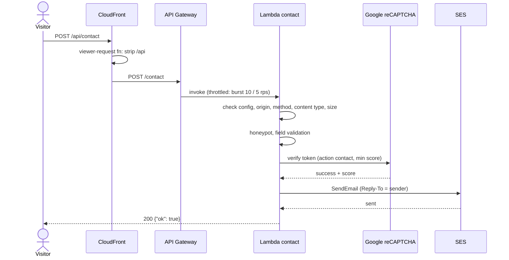

## Contact API

`POST /api/contact` (CloudFront strips `/api`, API Gateway route `POST /contact`, handler `lambda/contact/handler.py`). Public route, throttled to burst 10 / 5 requests per second.

### Request flow

The handler stops at the first failing step and returns the matching error from the table below.

### Request

`Content-Type: application/json`, `Origin` must be one of the site origins (apex or `www`), body up to 20 KB:

| Field | Required | Rules |
|---|---|---|
| `name` | yes | ≤ 120 chars |
| `email` | yes | ≤ 254 chars, valid email |
| `phone` | no | ≤ 40 chars |
| `projectType` | yes | ≤ 80 chars |
| `message` | yes | ≤ 4,000 chars |
| `locale` | yes | `pl`, `en` or `uk` |
| `projectId` | no | ≤ 80 chars |
| `consent` | yes | must be `true` |
| `recaptchaToken` | yes | Google reCAPTCHA v3 token, action `contact`, score ≥ `recaptcha_min_score` (default 0.5) |
| `company`, `honeypot` | no | honeypot fields; must be empty |

The message is emailed via SES from and to `ses_email`, with `Reply-To` set to the sender.

### Response

`{"ok": true}` on success, otherwise `{"ok": false, "error": {"code", "message"}}`:

| Status | Code |
|---|---|
| 400 | `INVALID_CONTENT_TYPE`, `PAYLOAD_TOO_LARGE`, `VALIDATION_ERROR`, `INVALID_REQUEST` (honeypot) |
| 403 | `ORIGIN_NOT_ALLOWED`, `CAPTCHA_FAILED` |
| 405 | `METHOD_NOT_ALLOWED` |
| 500 | `CONFIGURATION_ERROR` |
| 503 | `CAPTCHA_UNAVAILABLE`, `DELIVERY_FAILED` |

Run the tests with `cd lambda/contact && python -m unittest test_handler`.
